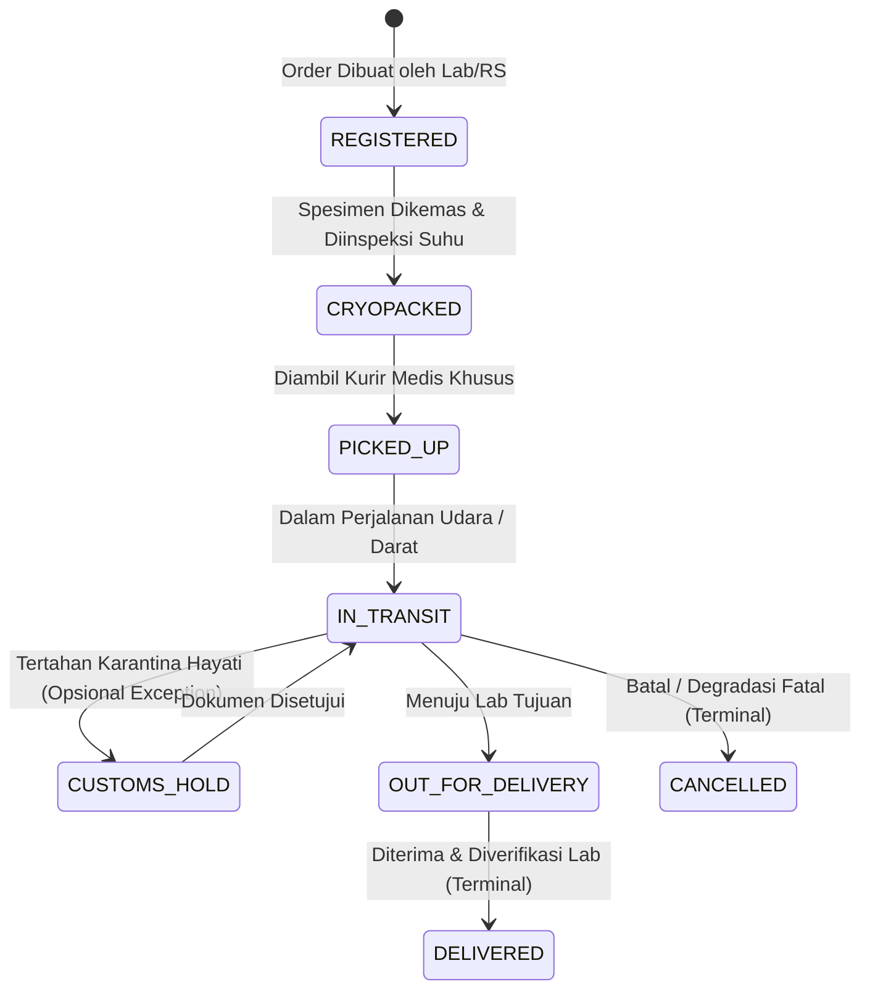
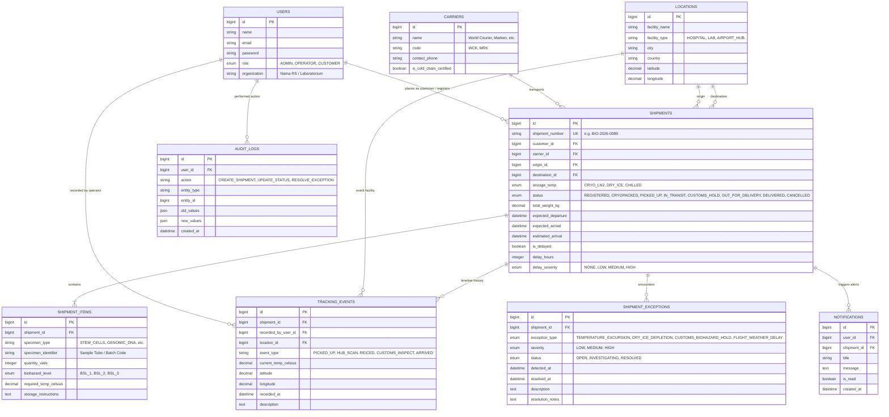

# BioTrace — Global Cold-Chain Biospecimen & Clinical Trial Visibility Platform
> **Web Programming 2 — Final Project (UAS)**
> Focused on Biomedical Logistics, Cold-Chain Viability & Global Shipment Visibility

---

## 1. Domain & Problem Statement
Dalam riset biomedis global, uji klinis multi-senter (*multi-center clinical trials*), dan terapi berbasis sel/gen (*cell & gene therapy*), pengiriman sampel biologis (seperti sel punca, kultur jaringan, plasma darah uji klinis, dan spesimen DNA/RNA) memerlukan pengawetan rantai dingin (*cold-chain*) yang sangat ketat (-196°C Liquid Nitrogen, -80°C Dry Ice, atau 2–8°C).

Keterlambatan (*delay*) atau gangguan suhu transit bukan sekadar masalah operasional logistik biasa, melainkan dapat **merusak integritas molekuler dan viabilitas sel hidup**.

**BioTrace** hadir sebagai platform visibilitas pengiriman global terpusat yang:
- Melacak perjalanan spesimen biomedis antar rumah sakit, hub transit kargo medis, dan laboratorium uji klinis di peta interaktif.
- Mengontrol transisi status pengiriman dengan aturan bisnis yang ketat (*state machine*).
- Menghitung risiko viabilitas sampel berdasarkan estimasi waktu tiba (ETA) vs durasi ketahanan pendingin (*cold-chain shelf life*).
- Mencatat dan mengelola insiden khusus seperti lonjakan suhu (*temperature excursion*), kehabisan es kering (*dry ice depletion*), dan penahanan karantina hayati (*customs biohazard inspection*).

---

## 2. User Roles & Permissions (RBAC)

| Role | Tanggung Jawab & Hak Akses |
| :--- | :--- |
| **Administrator** | - Mengelola pengguna & peran. - Mengelola master data carrier medis (Marken, World Courier, DHL Medical Express) dan lokasi fasilitas kesehatan / hub transit. - Konfigurasi parameter viabilitas & threshold keterlambatan. - Mengakses audit log dan seluruh dashboard metrik. |
| **Logistics Operator** | - Membuat dan memperbarui shipment spesimen biomedis. - Memasukkan *tracking event* (lokasi, suhu saat ini, status transit, catatan). - Mencatat dan memperbarui exception (misal: pengisian ulang es kering / *re-icing*). - Memantau status keterlambatan operasional harian. |
| **Customer (Lab / RS)** | - Melihat daftar spesimen yang dikirim atau ditujukan ke fasilitas mereka. - Melihat timeline kronologis dan posisi kargo di peta (Leaflet.js). - Menerima alert peringatan jika ada ancaman degradasi sampel akibat keterlambatan. |

---

## 3. Shipment Lifecycle & State Machine

Status pengiriman dikendalikan oleh validasi backend ketat (tidak boleh loncat sembarangan atau kembali dari status akhir `DELIVERED`):

---

## 4. Biomedical Cargo Classification

Setiap pengiriman memiliki item spesimen dengan karakteristik biomedis:
1. **Specimen Categories:**
   - `STEM_CELLS` (Sel Punca / Terapi Regeneratif)
   - `GENOMIC_DNA_RNA` (Sampel Genomik & PCR)
   - `BIOPSY_TISSUE` (Kultur Jaringan & Patologi Anatomi)
   - `CLINICAL_TRIAL_BLOOD` (Sampel Darah Uji Klinis Fase 2/3)
2. **Temperature Storage Tiers:**
   - `CRYO_LN2`: -196°C s/d -150°C (Liquid Nitrogen Vapor Shipper)
   - `DRY_ICE`: -80°C s/d -20°C (Dry Ice Insulated Shipper)
   - `CHILLED`: 2°C s/d 8°C (Gel Pack Shipper)
3. **Biohazard Levels:**
   - `BSL-1` (Low Risk)
   - `BSL-2` (Moderate Risk / Diagnostic Samples)
   - `BSL-3` (High Containment / Controlled Pathogens)

---

## 5. Delay Calculation & Exception Rules

### Aturan Keterlambatan (ETA vs Viability Threshold):
- $\text{Delay Duration} = \text{Current Estimated Arrival} - \text{Expected Arrival}$
- **Tingkat Keparahan Keterlambatan (Severity):**
  - **LOW (0 – 6 Jam):** Masih dalam batas cadangan pendingin; aman.
  - **MEDIUM (>6 – 12 Jam):** Membutuhkan penjadwalan *re-icing* (penambahan es kering) di hub transit terdekat.
  - **HIGH (>12 Jam):** Risiko tinggi degradasi integritas biomolekuler; peringatan kritis dikirim ke operator dan customer.

### Exception Types (Gangguan Pengiriman):
- `TEMPERATURE_EXCURSION`: Sensor membaca kenaikan suhu melebihi ambang batas toleransi tier pendingin.
- `DRY_ICE_DEPLETION`: Volume es kering menyusut mendekati batas aman sebelum tiba di tujuan.
- `CUSTOMS_BIOHAZARD_HOLD`: Penahanan dokumen karantina biologis oleh bea cukai bandara internasional.
- `FLIGHT_WEATHER_DELAY`: Keterlambatan penerbangan transit akibat cuaca buruk.
- `PACKAGING_BREACH`: Kerusakan fisik pada wadah luar (*outer shipper*).

Status Exception: `OPEN` $\rightarrow$ `INVESTIGATING` $\rightarrow$ `RESOLVED`.

---

## 6. Entity Relationship Diagram (ERD)

